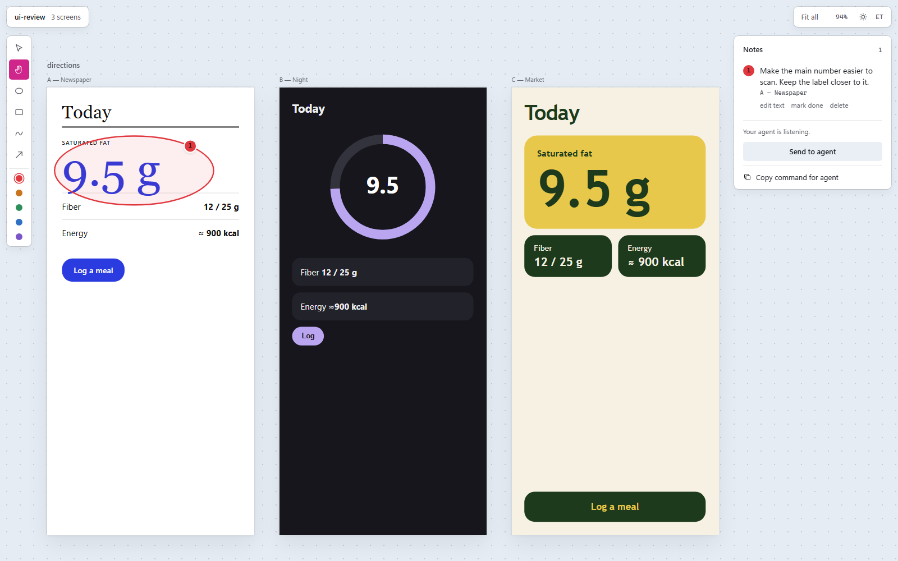

# BoardSimple

[In English](README.md)

Lihtne tasuta tahvel koodiagentide loodud kasutajaliidestele tagasiside andmiseks.

Kui sul pole vaja kõiki Paperi pakutavaid tööriistu, aga tahaksid lihtsat tahvlit agendi
pakutud UI-de ülevaatamiseks, on BoardSimple kerge võimalus. Vaata HTML-ekraane kõrvuti,
märgi, mida muuta, ja lase agendil tagasiside kohalikust failist lugeda. Kontot ega
tellimust pole vaja.



BoardSimple on varajases järgus kohalik tööriist. See kasutab agendi loodud HTML-faile;
töötava rakenduse URL-i manustada ei saa. Tegemist on iseseisva projektiga, mis pole
Paperiga seotud.

## Paigaldus

Vajab Node.js 24+. Npm-sõltuvusi pole.

```sh
npm install -g boardsimple
```

Või käivita üks kord ilma paigaldamata, oma projekti kaustas:

```sh
npx boardsimple
```

Hoia terminal tahvli kasutamise ajal töös; serveri peatamiseks vajuta Ctrl+C.
Kui PowerShell blokeerib npm-skriptid, kasuta Windowsis `npm.cmd`, `npx.cmd` ja `boardsimple.cmd`.

Demo on selles repos. Selle proovimiseks on vaja ka Giti:

```sh
git clone https://github.com/hallikkristjan-code/boardsimple.git
cd boardsimple
boardsimple examples/demo
```

## Anna agendile tagasisidet

1. Palu koodiagendil luua iseseisvad HTML-ekraanid projekti `screens/` kausta.
   Kopeeri [agendi juhend](AGENTS-BOARDSIMPLE.md) projekti `AGENTS.md` või `CLAUDE.md` faili.
2. Käivita ülemkaustas `boardsimple ./minu-projekt` või projekti sees `boardsimple`.
3. Võrdle ekraane, joonista ring, kast, joon või nool ning kirjuta, mida muuta.
4. Kui agent kuulab, vajuta **Saada agendile**. Muidu vajuta **Kopeeri käsk agendile** ja
   kleebi käsk vestlusesse.
5. Agent loeb `.canvas/annotations.json` faili ja muudab HTML-i. Tahvel uueneb automaatselt.

Märkused jäävad projekti `.canvas/` kausta. Kaasa see varukoopiatesse; kui tagasiside on
privaatne, lisa kaust projekti `.gitignore` faili. BoardSimple salvestab tagasiside
kohalikult; laaditavad HTML-ekraanid võivad siiski küsida väliseid ressursse.

### Saada otse agendile

Palu agendil käivitada projekti kaustas `boardsimple wait` (agendi juhend ütleb seda talle).
Käsk avab vajadusel tahvli ja jääb ootama. Märkuste paneel näitab, kas agent kuulab. Kui kuulab,
annab **Saada agendile** talle avatud märkused ja agent asub oma vestluses tööle. Igal saatmisel
salvestub koopia `.canvas/feedback-<id>.json`, mistõttu hilisem muutmine ei muuda saadetud
ülesannet. Saatmine ise ei märgi märkusi tehtuks, ei tee commit'i ega avalda midagi.

Proovitud Windowsis T3 Code'i kaudu käivitatud Claude Code'iga. Codexi käsureaga töötavad ootamine
ja ajapiir; tagasiside jõudmist Codexini pole veel proovitud. Teisi agente ja süsteeme pole proovitud ning mõni agent peatab kaua kestvad käsud varem;
**Kopeeri käsk agendile** töötab alati.

`boardsimple wait`-i käivitatud tahvel töötab ilma terminalita ja lõpetab ise, kui 30 minutit
pole ükski tahvliaken lahti ega ükski agent oota. Käsitsi käivitatud tahvel töötab, kuni vajutad
Ctrl+C.

## Kasutus

```sh
boardsimple                 # praegune kaust
boardsimple ./minu-projekt
boardsimple --port 5000 --no-open
boardsimple wait            # agendile: ava tahvel ja oota „Saada agendile“ vajutust
```

Lõuend avaneb eraldi aknas (Chrome, Edge, Chromium või Brave `--app`-režiimis): oma taskbar-kirje,
Alt+Tab-is nähtav, tabide vahele ei kao. Aknal on oma profiil (`~/.boardsimple/chrome-profile`), nii et suurus ja
asukoht jäävad meelde. Mujalt klikitud lõuendi link jõuab tavatabi. Kui tahvli akent pole lahti, avab tab selle ja sulgeb
end, muidu jääb tab töötavaks lõuendiks.
Kui ühtki neist pole, avaneb tavabrauseris.

Proovi repo kloonis demoga: `boardsimple examples/demo` (inglise keeles `examples/demo-en`).

- **Ekraanid:** `screens/<rühm>/<nimi>.html`, suurus `<meta name="artboard" content="width=390,height=844">`.
- **Tööriistad:** Vali (V) — klõpsa ja keri ekraani sees · Käsi (H või tühik) — nihuta · Ring (O), Kast (B), Joon (P), Nool (A) — märgi. Joon sulgub, kui lõpetad alguse lähedal; muidu jääb allakriipsutuseks. Värv kehtib järgmistele märkidele.
- **Suum:** hiireratas või pinch; "Mahuta kõik" (Shift+1).
- **Agendile:** märkused salvestuvad kohe `.canvas/annotations.json`-i; kustutatud märkuse saab mõne sekundi jooksul tagasi võtta. Saada avatud märkused ootavale agendile (`boardsimple wait`) või kopeeri käsk vestlusesse.
- **Keel:** äpp järgib brauserit (eesti keel, kui see on loetelus, muidu inglise). ET/EN nupp teema nupu kõrval vahetab keelt ja jätab valiku meelde. Käsurida järgib süsteemi keelt; `BOARDSIMPLE_LANG=et` või `en` kirjutab selle üle.
- **Tõrkeotsing:** kui GPU protsess kukub või lähtestub, tekib rida faili `.canvas/client.log`. Puuduvaid graafikatükke see ei märka.

Agendi juhend projekti `CLAUDE.md`-sse: [AGENTS-BOARDSIMPLE.md](AGENTS-BOARDSIMPLE.md) ([in English](AGENTS-BOARDSIMPLE.en.md)).

Server kuulab ainult `127.0.0.1` ja keeldub võõra `Origin`/`Host` päisega päringutest.
Ekraanid töötavad eraldi kohaliku, ainult lugemiseks mõeldud aadressi sandbox-raamides: nende
skriptid, kohalikud moodulid ja fondid töötavad, kuid ei pääse tahvli DOM-i ega agendinuppude juurde.
Ekraani brauserisalvestus kuulub sellele eraldi aadressile. Mõõtmed ja märgitud elemendid liiguvad piiratud sõnumiliidese kaudu.

## Arendus

```sh
npm test                      # node-testid
python -I test/e2e/e2e.py     # brauseri e2e (pip install playwright && playwright install chromium)
python -I test/e2e/marks.py   # märkimise tööriistad ja värvid
python -I test/e2e/agents.py  # kuulamise olek, saatmine ootavale agendile, ekraanide eraldus
python -I test/e2e/a11y.py    # klaviatuur, tagasivõtt ja kontrast
python -I test/e2e/touch.py   # üks ja kaks sõrme, kitsas aken
python -I test/e2e/window.py  # üleandmine tabist app-aknale
python -I test/e2e/load.py    # 146 lehe koormusproov; BOARDSIMPLE_E2E_GPU=1 lisab Windowsil GPU mälu piiri
```

CI jooksutab kõik (node-testid Ubuntul ja Windowsil, e2e ja koormusproov Ubuntul). GPU piiri CI ei kontrolli, sest seal pole päris GPU-d.

## Litsents

[MIT](LICENSE). Tasuta kasutamiseks, muutmiseks ja jagamiseks.
